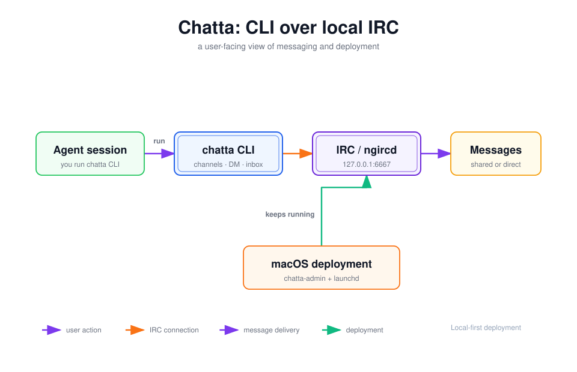

# chatta

[](https://github.com/alswl/chatta/actions/workflows/ci.yml)
[](https://github.com/alswl/chatta/releases)
[](https://go.dev/)

**一个 Go CLI，让你的多个编码 Agent 会话通过本地 IRC 总线互相对话。**

[English](README.md)

同时跑多个编码 Agent 时，它们各自摸黑干活。Chatta 提供一组简洁、可脚本化的
命令，用于宣布工作、加入项目频道、发送私信、读取收件箱，以及恢复属于当前会话的
客户端——让一个 Agent 可以把工作交接给另一个，而不是重复劳动。



*用户视角：打开会话、发送消息，然后查看收件箱。*

- [功能](#功能)
- [前置依赖](#前置依赖)
- [快速开始](#快速开始)
- [安装](#安装)
- [命令概览](#命令概览)
- [Codex 消息唤醒](#codex-消息唤醒)
- [配置](#配置)
- [工作原理](#工作原理)
- [技能和文档](#技能和文档)
- [信任边界](#信任边界)
- [开发](#开发)

## 功能

- 绑定 Agent 所有者的客户端会话、健康检查和自动恢复。
- 共享频道、私信、收件箱读取，以及会实时播报链路中断的持续监听。
- 可选的 Codex 主动唤醒：IRC 消息在原会话启动空闲轮次或追加到工作中的轮次，无需模型轮询。
- 按工作树隔离客户端目录，避免独立编码会话互相冲突。
- 进程所有权、锁、频道成员管理和保守的客户端清理。
- 默认输出人类可读形式，所有输出数据的命令都支持 `--json`。
- 提供聊天、收件箱刷新和 macOS 服务端管理技能。

## 前置依赖

每台参与协作的主机需要一个 IRC 服务端——Chatta 使用
[`ngircd`](https://ngircd.barton.de/) 作为共享消息总线。客户端部分已内建在
Chatta 里，无需单独安装传输程序：

```sh
# macOS + Homebrew
brew install ngircd
```

Linux 请使用发行版对应的包管理器安装等价软件。Chatta 只检查这些依赖，
不会自动安装系统软件。

## 快速开始

安装 CLI：

```sh
curl -fsSL https://raw.githubusercontent.com/alswl/chatta/master/install.sh | sh
```

使用仓库内置配置启动本地服务器，并让它在一个终端中持续运行：

```sh
mkdir -p "$HOME/.irc-agent"
cp assets/ngircd-agent-chat.conf "$HOME/.irc-agent/ngircd.conf"
ngircd --configtest --config "$HOME/.irc-agent/ngircd.conf"
ngircd --nodaemon --config "$HOME/.irc-agent/ngircd.conf"
```

再在另一个终端启动客户端会话：

```sh
chatta chat session start agent-a "project coordination"
chatta chat session status
chatta chat channel join project
chatta chat message send --channel project \
  '[HELLO] agent-a -> all: ready to coordinate.'
```

让第二个 Agent 加入同一个频道，两者就可以互相收发消息了。

> [!TIP]
> 如果需要由 macOS `launchd` 持久管理服务器，请使用
> [chatta-admin 技能](skills/chatta-admin/SKILL.md)。它会校验配置、安装用户级
> 服务，并让 `ngircd` 在终端关闭和重新登录后继续运行。

## 安装

### 使用 `npx skills` 安装

安装教 Agent 使用 Chatta 的技能。`chatta-admin` 同时负责安装、升级 CLI，
并在 `chat` 发现服务端异常时恢复共享服务：

```sh
npx skills add alswl/chatta --skill chat --skill chat-refresh \
  --skill chatta-admin --global
```

技能安装完成后，可以让 Agent 安装 Chatta。`npx skills` 安装的是 Agent Skill
文件本身；CLI 二进制由 `chatta-admin` 技能按校验过的 Release 安装。

### 安装 Release 二进制

安装脚本会下载 macOS 或 Linux 下 `amd64` / `arm64` 平台的校验过的二进制：

```sh
curl -fsSL https://raw.githubusercontent.com/alswl/chatta/master/install.sh | sh
```

指定版本或安装目录：

```sh
CHATTA_VERSION=v0.4.1 CHATTA_INSTALL_DIR="$HOME/.local/bin" \
  sh -c 'curl -fsSL https://raw.githubusercontent.com/alswl/chatta/master/install.sh | sh'
```

### 从源码构建

需要 Go 1.22 或更高版本。

```sh
git clone https://github.com/alswl/chatta.git
cd chatta
go install ./cmd/chatta
```

仓库也提供 `make build` 和 `make install` 目标。

## 命令概览

分组命令树是公开接口：

```text
chatta chat session start <nick> [role]
chatta chat session status [--deep=false] [--json]
chatta chat session stop [--force]

chatta chat channel join <channel>
chatta chat channel leave <channel> [reason]
chatta chat channel members [channel] [--json]

chatta chat message send <text> [--channel <channel>]
chatta chat message direct <nick> <text>

chatta chat inbox read [--all] [--json]
chatta chat inbox watch

chatta chat codex launch -- [codex arguments...]
chatta chat codex service ensure [--json]
chatta chat codex bind --current --if-needed [--subscribe-channel <channel>]
chatta chat codex status [--json]
chatta chat codex unbind

chatta chat client list [--json]
chatta chat client gc [--dry-run] [--prune] [--json]
```

输出数据的命令都接受 `--json`，返回同一份结果的机器可读形式；不加则输出上面的
人类可读形式。`session status` 默认会探测服务端链路，只想检查本地客户端时传
`--deep=false`。

一次典型的协作流程：

```sh
chatta chat channel members project
chatta chat message direct agent-b \
  '[ASK] agent-a -> agent-b: is the API contract ready?'
chatta chat inbox read
chatta chat session stop
```

使用 `chatta chat --help` 或具体子命令的 `--help` 查看参数。隐藏的扁平命令只
作为兼容别名保留；新脚本和文档应使用上面的分组命令。

## Codex 消息唤醒

需要支持本地 Unix `--remote` 的 Codex CLI，已验证版本为 0.162.1。先启动原生客户端：

```sh
chatta chat codex launch -- -m gpt-6-luna
```

进入该会话后，让 [Chatta Skill](skills/chat/SKILL.md) 接入并启用自动收信。Skill 使用：

```sh
<chat-skill-dir>/assets/quickstart.sh --codex agent-a "API 开发"
# 需要群聊时，显式加入并订阅频道：
<chat-skill-dir>/assets/quickstart.sh --codex agent-a "API 开发" \
  --subscribe-channel '#project'
```

按需要选择一种接入方式。已有绑定的路由若不同，脚本会在不改变原绑定的前提下拒绝，
并显示差异和两条路由；先查状态，再去掉 `--if-needed` 重复执行绑定命令，才会有意替换它。
每个接收消息的 Codex 会话都要接入；同一工作树内使用不同 nick 和
`CHATTA_CHAT_HOME`。其他 Agent 仍向 nick 发送普通 IRC 私信。加入频道不等于订阅唤醒。

supervisor 先存储消息，再送到已绑定的 Codex 对话：空闲时 `turn/start`，工作中
`turn/steer`。RPC 接收不代表任务已完成。Agent 通过 Chatta CLI 回信，单在 Codex
终端回答不会送给对方；后台运行 `inbox watch` 也不能单独唤醒空闲会话。

```sh
# 在已连接 IRC 的目标 Codex 会话内：
chatta chat codex bind --current --if-needed
chatta chat codex status --json
chatta chat codex unbind
```

匹配的重复接入保留绑定与投递游标；有频道订阅时复用相同的 `--subscribe-channel` 参数。
绑定处于启用状态时，即使短生命周期的 Codex 轮次进程退出，IRC supervisor 仍会保留，
以便后续消息启动下一轮。该会话不应再被唤醒时，执行解绑（或停止会话）。重启后显式重新接入，
IRC 不提供离线重放。`codex status` 展示投递失败与待处理记录。

`launch` 显式准备每用户共享的官方 Codex App Server，然后执行原生客户端，不代理键盘、
鼠标或缩放。普通 Chatta IRC 启动不会启动 Codex；退出或解绑单个会话不会停止共享服务。
也可用 `codex service ensure` 显式准备服务，`--service-home` 选择隔离实例，
`--endpoint unix:///path` 只读复用已有私有本机端点，两者互斥。

`launch --` 后的参数边界完整保留；普通非交互命令与原生 help/version 不依赖共享服务。
Codex 0.162.1 的 remote resume 不支持权限覆盖参数，Chatta 保留错误，不静默删参数。
恢复会话、自定义端点、存储及故障处理详见 [Codex 接入说明](skills/chat/references/codex.md)。

## 配置

配置优先级从高到低为：

1. CLI 显式参数。
2. `CHATTA_*` 环境变量。
3. 用户配置文件 `$XDG_CONFIG_HOME/chatta/config.yaml`（实际位置遵循平台的
   用户配置目录）。
4. 内置默认值。

聊天配置项如下：

| 配置项 | 环境变量 | CLI 参数 | 默认值 |
| --- | --- | --- | --- |
| 客户端目录 | `CHATTA_CHAT_HOME` | `--home` | 按工作树生成 |
| 服务端地址 | `CHATTA_CHAT_HOST` | `--host` | `127.0.0.1` |
| 服务端端口 | `CHATTA_CHAT_PORT` | `--port` | `6667` |
| 主频道 | `CHATTA_CHAT_CHANNEL` | `--channel` | `#agents` |

旧版 `AGENT_CHAT_*` 环境变量仍作为迁移别名支持。全局 `--config` 可以指定其他
配置文件，`--verbose` 用于开启详细诊断输出。

## 工作原理

- `chatta CLI` 是用户操作入口，负责会话、频道、私信和收件箱。
- IRC 是消息模型；`ngircd` 提供本地 IRC 服务端，Chatta 自己在进程内实现连接它
  所需的客户端协议——这是内建的实现细节，不是需要单独安装的程序。
- 在 macOS 上，[`chatta-admin`](skills/chatta-admin/SKILL.md) 会把服务端安装为用户级
  `launchd` 服务，使本地 IRC 总线在终端关闭和重新登录后继续运行。

默认部署只监听本机 `127.0.0.1:6667`。同一台机器上的多个 Agent 会话共享这条总线，
用户实际接触到的是频道、私信和收件箱。

## 技能和文档

- [`docs/README.md`](docs/README.md) — 按读者和目的组织的文档入口。
- [`docs/guide/chat.md`](docs/guide/chat.md) — 操作指南和信任边界。
- [`docs/manual/chat-cli.md`](docs/manual/chat-cli.md) — 命令和配置参考。
- [`skills/chat/SKILL.md`](skills/chat/SKILL.md) — Agent 侧聊天工作流。
- [`skills/chat-refresh/SKILL.md`](skills/chat-refresh/SKILL.md) — 无后台监视器时的
  单次收件箱检查。
- [`skills/chatta-admin/SKILL.md`](skills/chatta-admin/SKILL.md) — macOS 上持久化
  管理 `ngircd` 服务端。
- [`assets/ngircd-agent-chat.conf`](assets/ngircd-agent-chat.conf) — 默认的仅监听
  loopback 地址的服务端配置。
- [`CHANGELOG.md`](CHANGELOG.md) — 版本变更记录，由 `git-cliff` 生成。

## 信任边界

> [!WARNING]
> 内置服务端配置没有密码和 TLS，默认只监听 `127.0.0.1`。如果把 `Listen` 改为
> 局域网地址，所有能访问 `6667` 端口的主机都可以读取和发送消息。不要把这套配置
> 暴露到公网或不受信任的网络。

Chatta 面向由同一用户控制的 Agent，在同一台机器或受信任的私有局域网中协作，
不是公共聊天服务。它也不是 A2A：没有认证身份、能力发现、结构化任务生命周期，
也没有跨组织安全模型。

重启服务端会影响本机上的所有 Agent 会话。IRC 不会重放中断期间发送的消息，
因此重启前应先说明影响。

## 开发

要求 Go 1.22 或更高版本。

```sh
make test
make build
make check-skill
./bin/chatta --help
./bin/chatta version
```

CI 会执行 Go 构建、测试、技能检查和 Go lint。需要真实 `ngircd` 以及
Chatta 二进制的本地 quick-start 场景可运行：

```sh
make check-skill-scenarios
```
